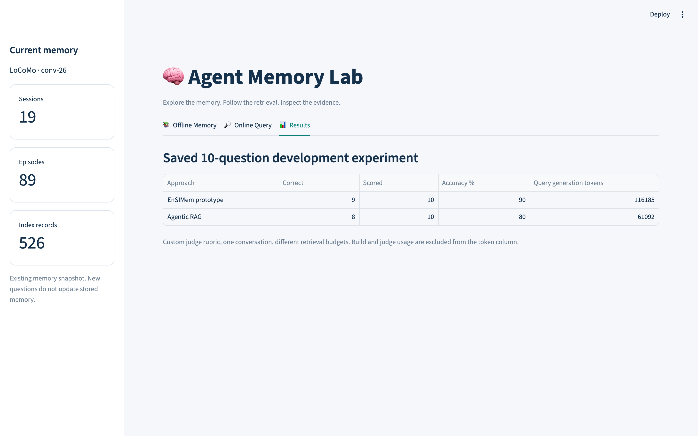

# Agent Memory Experiment Lab

Microservices experiment platform for Agentic RAG and EnSIMem.

## Goals
- Execute reproducible experiments with API-hosted models.
- Measure build and query tokens separately.
- Preserve source evidence and execution traces.
- Track evaluation usage separately.

Status: scaffold only; services are not implemented yet.

## Benchmarks

Saved 10-question development experiment on LoCoMo `conv-26`, from the
Streamlit playground's **📊 Results** tab:



| Approach | Correct / Scored | Accuracy | Query generation tokens |
|---|---|---|---|
| EnSIMem prototype | 9 / 10 | 90% | 116,185 |
| Agentic RAG | 8 / 10 | 80% | 61,092 |

Custom judge rubric, one conversation, different retrieval budgets. Build and
judge usage are excluded from the token column.

Run the playground locally:

```bash
.venv/bin/streamlit run apps/frontend/playground.py
```
