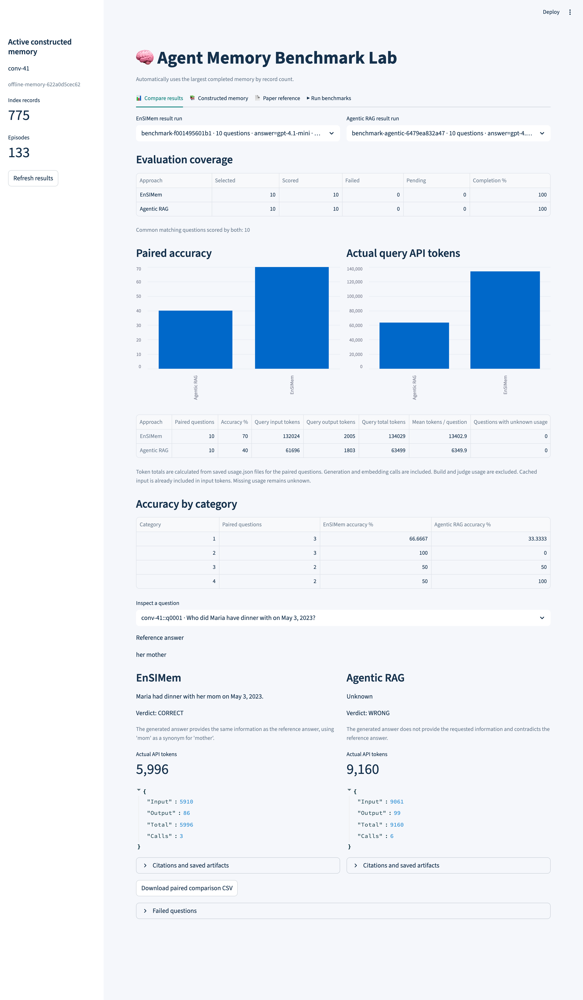
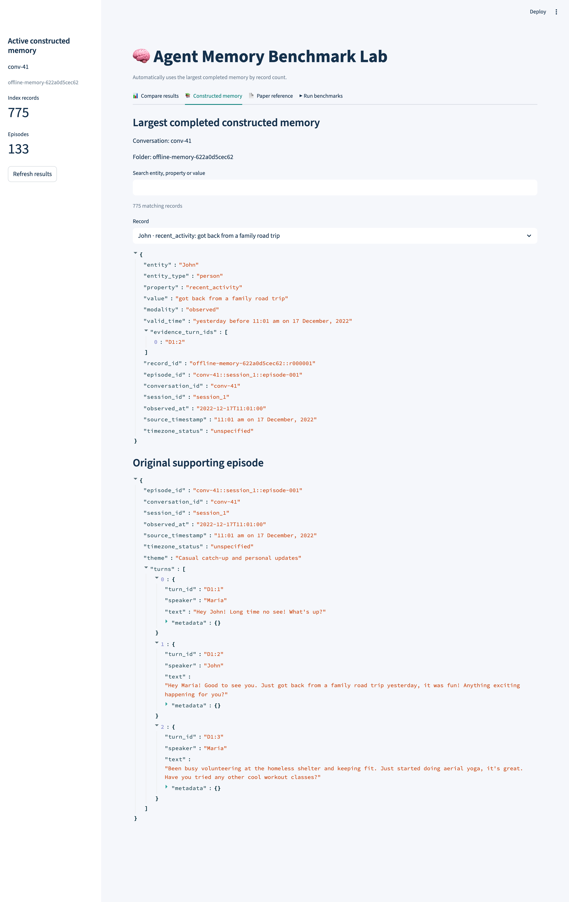
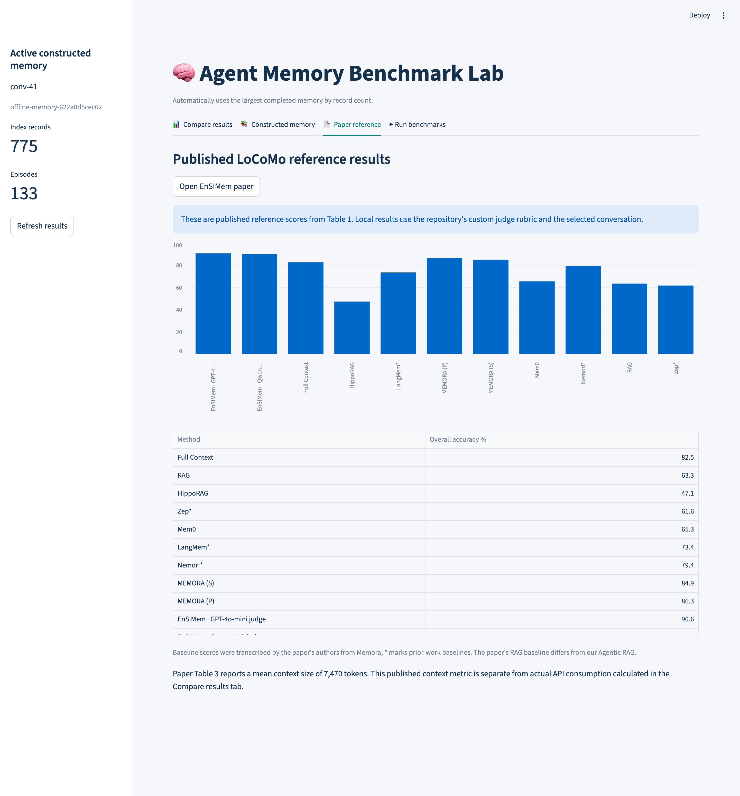
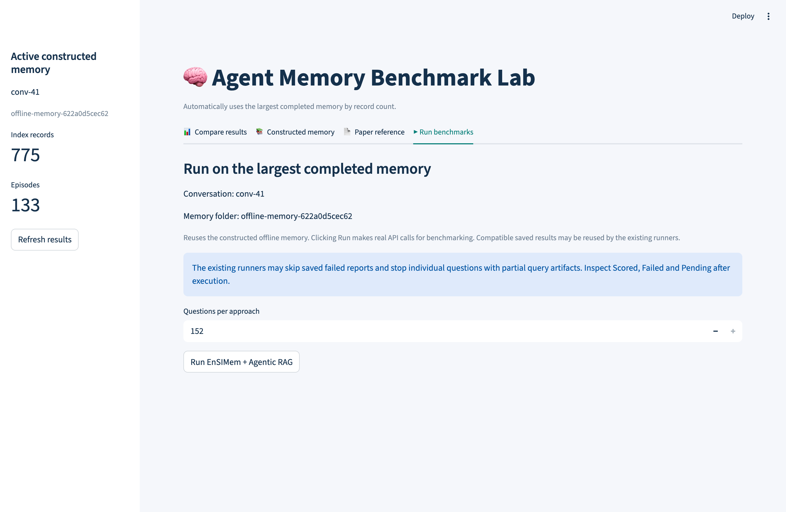

# Agent Memory Experiment Lab

Microservices experiment platform for Agentic RAG and EnSIMem.

## Goals
- Execute reproducible experiments with API-hosted models.
- Measure build and query tokens separately.
- Preserve source evidence and execution traces.
- Track evaluation usage separately.

Status: scaffold only; services are not implemented yet.

## Benchmarks

Paired 10-question run on LoCoMo `conv-41`, using the largest completed
offline memory (`offline-memory-622a0d5cec62`: 133 episodes, 775 index records).
Both approaches answer with `gpt-4.1-mini`.

| Approach | Accuracy | Query input tokens | Query output tokens | Query total tokens | Mean tokens / question |
|---|---|---|---|---|---|
| **EnSIMem** | **70%** | 132,024 | 2,005 | 134,029 | 13,402.9 |
| Agentic RAG | 40% | 61,696 | 1,803 | 63,499 | 6,349.9 |

Accuracy by LoCoMo category:

| Category | Paired questions | EnSIMem | Agentic RAG |
|---|---|---|---|
| 1 | 3 | 66.7% | 33.3% |
| 2 | 3 | 100% | 0% |
| 3 | 2 | 50% | 50% |
| 4 | 2 | 50% | 100% |

Token totals come from the saved `usage.json` files for the paired questions.
They include generation and embedding calls and exclude build and judge usage.
Results use the repository's custom judge rubric on one conversation, so they
are not directly comparable to the published scores.

### 📊 Compare results



### 📚 Constructed memory



### 📄 Paper reference



### ▶ Run benchmarks



## Run the dashboard locally

```bash
.venv/bin/streamlit run apps/frontend/benchmark_dashboard.py
```

> Clicking **Run EnSIMem + Agentic RAG** makes real, billed API calls.
